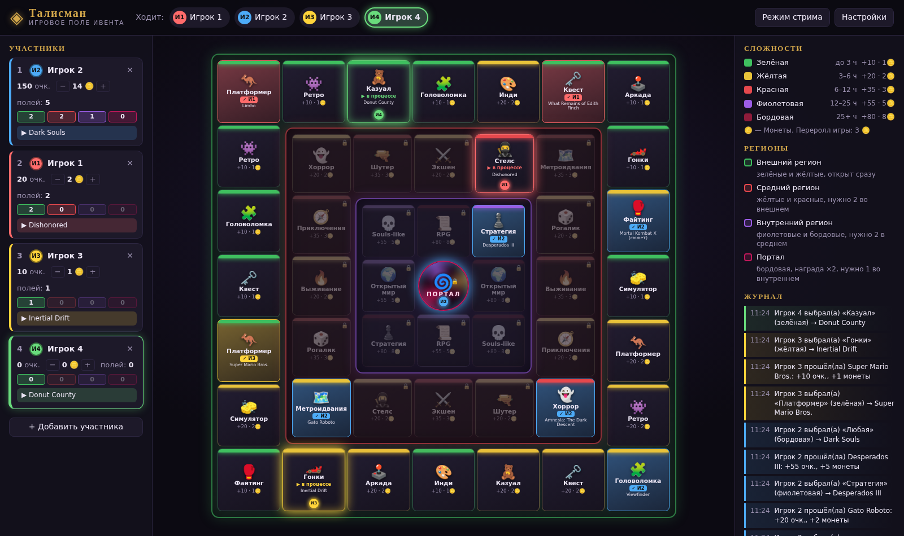

# Талисман — игровое поле ивента для стримеров

Статическая веб-страница без сборки и зависимостей: откройте `index.html` в браузере или подключите как Browser Source в OBS.

## Поле

Три вложенных квадратных кольца и портал в центре — чем ближе к центру, тем длиннее игры и выше награда.

| Регион | Полей | Сложности |
|---|---|---|
| Внешний | 24 | зелёная, жёлтая |
| Средний | 16 | жёлтая, красная |
| Внутренний | 8 | фиолетовая, бордовая |
| Портал | 1 | бордовая, награда ×2 |

Каждое поле — тематика + сложность. При выборе поля игра случайно выпадает из пула игр этой тематики и сложности (уже разыгранные исключаются).

## Как играть

1. Сверху выберите, кто ходит.
2. Нажмите на поле → «Выбрать поле». Поле подсвечивается цветом игрока, на табло появляется баннер.
3. В карточке поля: «Пройдено» (очки + бонусная валюта), «Дроп» (поле снова свободно), «Переролл» (за валюту), «Отменить».
4. Наведите на участника слева — на карте подсветятся только его поля.
5. «Режим стрима» скрывает панели, Esc — вернуть.

По умолчанию регионы открываются постепенно (2 поля во внешнем → средний, 2 в среднем → внутренний, 1 во внутреннем → портал).

## Настройки

- **Награды** — очки и валюта за каждую сложность, подписи длительности.
- **Правила** — открытие регионов, множитель портала, цена переролла, штраф за дроп, название валюты.
- **Пул игр** — редактирование, удаление, добавление списком (`Название; Тематика; сложность`).
- **Данные** — экспорт/импорт JSON, сброс прогресса.

Состояние сохраняется в `localStorage` браузера. Стартовые данные — в `js/data.js`.
